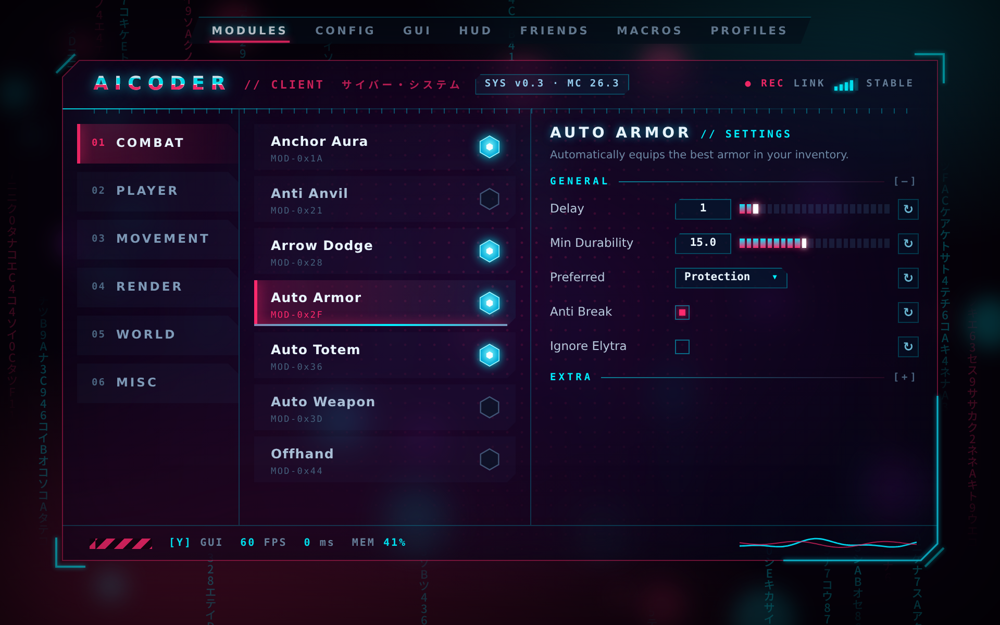

# AiCoder client

Meteor Client addon（Minecraft 26.3）。目前只包含一個賽博龐克風格的 GUI 主題，會直接取代 Meteor 預設主題。



## 建置

需要 JDK 25。

```
./gradlew build
```

產物在 `build/libs/aicoder-client-<version>.jar`，和 Meteor Client 一起放進 `mods/` 即可。

## 使用

- 點模組列：選取，右欄顯示設定
- 點六角形，或對模組列按右鍵：開關模組
- `Ctrl+F`：搜尋模組與設定
- 建議開啟 Meteor 的 **Blur** 模組，玻璃視窗後方會有模糊效果
- 顏色、背景壓暗程度、資料雨與光點都可以在 GUI 分頁調整

同一時間只能安裝一個取代 Meteor 主題的 addon。啟動時 log 會出現一筆
`Theme with the name 'Meteor' has already been added.`，這是取代主題時的正常訊息。

設計稿與實作說明見 `CLAUDE.md` 與 `design/`。

---

# AiCoder 地球科學（`earth-science/`）

第二個獨立的 Meteor addon，產出 `AiCoder地球科學.jar`。內含十個可以來回切換的 GUI 主題：

| # | 主題 | # | 主題 |
|---|---|---|---|
| 01 | 地層 Strata | 06 | 大氣 Atmosphere |
| 02 | 火山 Magma | 07 | 地震儀 Seismograph |
| 03 | 冰河 Glacier | 08 | 礦物晶體 Geode |
| 04 | 深海 Abyss | 09 | 衛星地球 Orbit |
| 05 | 地形圖 Topography | 10 | 琥珀化石 Amber |

## 建置

```
cd earth-science
./gradlew build
```

產物在 `earth-science/build/libs/AiCoder地球科學.jar`。檔名含中文，建置時的系統語系要是 UTF-8
（例如 `LC_ALL=C.UTF-8`），否則 Gradle 寫不出這個檔名。

## 切換主題

- Modules 視窗標題列右側的 `◀ 03/10 ▶`：上一個／下一個主題，會循環
- 或在 GUI 分頁的「Theme」下拉選單直接選（名稱為 `AiCoder 01 Strata` … `AiCoder 10 Amber`）
- 第一次安裝會自動切到 01 地層；Meteor 原本的主題仍在下拉選單裡
- 每個主題的顏色各自存檔，GUI 分頁的「Backdrop Opacity」可調整背景遮住遊戲畫面的程度（0 = 關閉背景）

操作方式和賽博龐克主題相同：點模組列選取、點開關圖示或按右鍵開關模組、`Ctrl+F` 搜尋。

主題的中文名稱只有在關閉 Config 的「Custom Font」時才會顯示在標題列（Meteor 的自訂字型沒有中文字）。

---

# AiCoder 液態玻璃（`liquid-glass/`）

第三個獨立的 Meteor addon，產出 `AiCoder液態玻璃.jar`：圓角玻璃視窗，兩種顏色由左上漸層到右下。

```
cd liquid-glass
./gradlew build      # 系統語系要是 UTF-8，產物在 build/libs/AiCoder液態玻璃.jar
```

在 GUI 分頁最下方的 **Liquid Glass** 區塊調整：

| 設定 | 作用 |
|---|---|
| Color | 開＝用下面兩個顏色上色；關＝沒有顏色的透明玻璃 |
| Color 1 / Color 2 | 玻璃左上／右下的顏色 |
| Glass Opacity | 玻璃的實心程度，越低越透 |
| Liquid Motion | 玻璃內緩慢流動的光斑 |
| Auto Blur | 開啟 GUI 時自動打開 Meteor 的 Blur 模組，讓玻璃後方的畫面變模糊 |
| Backdrop Dim | 遊戲畫面壓暗的程度 |

主題名稱是 `AiCoder Glass`，第一次安裝會自動選用；Meteor 原本的主題仍在 Theme 下拉選單裡。
操作方式和另外兩個 addon 相同：點模組列選取、點圓形開關或按右鍵開關模組、`Ctrl+F` 搜尋。

---

# AiCoder 多欄賽博龐克（`columns/`）

第四個獨立的 Meteor addon，產出 `AiCoder多欄賽博龐克.jar`：沿用 Meteor 原本「每個分類一欄、左右並排」的版面，換成賽博龐克外觀，並加上開關音效。

```
cd columns
./gradlew build      # 系統語系要是 UTF-8，產物在 build/libs/AiCoder多欄賽博龐克.jar
```

- 左鍵點模組＝開關（開是上升的合成音、關是下降的），右鍵＝開啟該模組的設定視窗
- 滑鼠停在模組上會在旁邊出現說明卡：名稱、說明、編號與開關狀態
- 多了一個青色的 **AICODER** 分類欄，目前裡面沒有模組
- 放不下的視窗（Search、Favorites）會排到最短那一欄的下面；欄位都可以拖曳，位置會記住
- GUI 分頁的 **Cyber** 區塊可以關掉音效（Toggle Sound）或調音量（Sound Volume），也能調背景壓暗、資料雨、光點

這個主題和第一個「賽博龐克」一樣是**取代** Meteor 原本的主題，兩個不能同時安裝。

---

# AiCoder 液態玻璃直立式（`glass-columns/`）

第五個獨立的 Meteor addon，產出 `AiCoder液態玻璃直立式.jar`：液態玻璃的外觀，配上「每個分類一欄」的直立式版面，開關模組時有水滴落在玻璃上的音效。

```
cd glass-columns
./gradlew build      # 系統語系要是 UTF-8，產物在 build/libs/AiCoder液態玻璃直立式.jar
```

- 左鍵點模組＝開關（開是往上的水滴聲、關是往下的），右鍵＝開啟該模組的設定視窗
- 滑鼠停在模組上會在旁邊出現說明卡
- 顏色、透明度、音效開關與音量都在 GUI 分頁的 **Liquid Glass** 區塊，和原本的液態玻璃相同，多了 Toggle Sound 與 Sound Volume
- 主題名稱是 `AiCoder Glass Columns`，可以和原本的液態玻璃一起安裝，在 Theme 下拉選單切換

---

# 壁紙（液態玻璃、液態玻璃直立式）

兩個液態玻璃 addon 的面板裡可以顯示一張圖片：圖片以「鋪滿整個畫面」的方式排版，但只有面板內看得到，
所以每一欄像是同一張圖的窗口，面板以外仍然是遊戲畫面。

- 內建一張 `Crimson Scythe`，預設啟用
- 加自己的圖：把 PNG 或 JPG 放進遊戲資料夾的 `meteor-client/aicoder-wallpapers/`（開過一次 GUI 後會自動建立），
  回到 GUI 分頁，在 **Wallpaper** 區塊的下拉選單選它。兩個 addon 共用這個資料夾
- `Wallpaper` 選 `None` 就是沒有圖片的純玻璃
- `Wallpaper Opacity`：圖片的濃淡；`Glass Opacity`（Liquid Glass 區塊）：蓋在圖片上的玻璃顏色有多實
